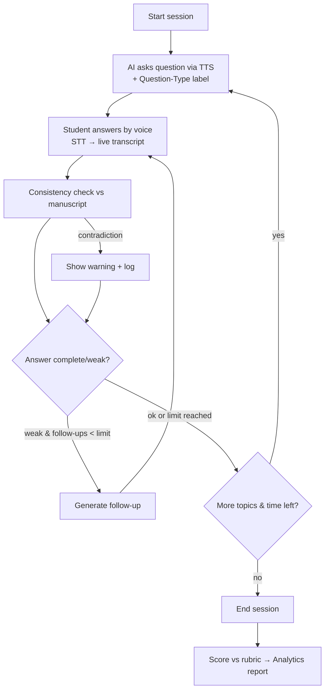
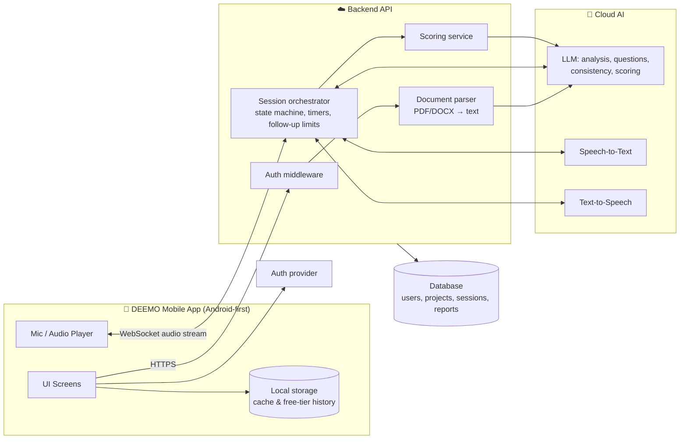
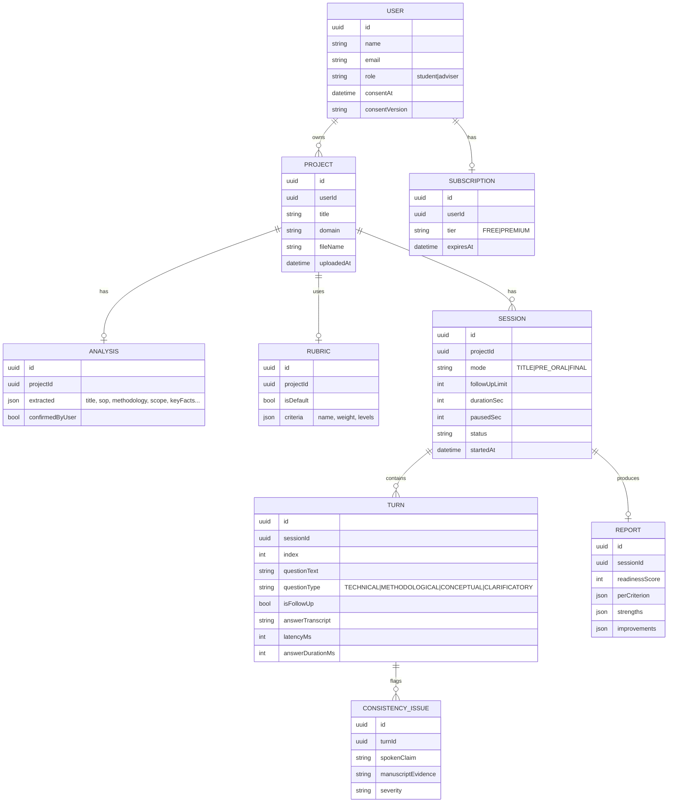

# DEEMO — Mobile App Development Plan

**Based on:** Chapter 1 of *"DEEMO: A Voice-Interactive Mock Panel Simulator for Capstone Defense Preparation of 4th Year BSIT Students in Pinamalayan Maritime Foundation and Technological College, Inc."* (4B – Kimberly's Group)
**Proponents:** Lacdao, P.D.M. · Lat, M.I.R. · Macatangay, K.L. · Mamba, K.F. · Monton, J.D.
**Source scope:** Chapter 1 only (Introduction, Background, SOP, Objectives, Significance, Scope & Delimitation, Definition of Terms, Conceptual Framework).

> **Legend**
> - 📘 **CH1** = taken directly from Chapter 1
> - 💡 **REC** = recommendation / design decision added by this plan (not stated in Chapter 1)

---

## Table of Contents

1. [Chapter 1 Summary](#1-chapter-1-summary)
2. [Objective → Feature Traceability](#2-objective--feature-traceability)
3. [Product Overview](#3-product-overview)
4. [Feature Specification](#4-feature-specification)
5. [Out of Scope (Delimitations)](#5-out-of-scope-delimitations)
6. [Information Architecture & Navigation](#6-information-architecture--navigation)
7. [Screen Inventory](#7-screen-inventory)
8. [Core User Flows](#8-core-user-flows)
9. [Mock Defense Session Engine](#9-mock-defense-session-engine)
10. [AI Pipeline Design](#10-ai-pipeline-design)
11. [System Architecture](#11-system-architecture)
12. [Tech Stack](#12-tech-stack)
13. [Data Model](#13-data-model)
14. [Backend API](#14-backend-api)
15. [Freemium Model](#15-freemium-model)
16. [Non-Functional Requirements](#16-non-functional-requirements)
17. [Security & Data Privacy](#17-security--data-privacy)
18. [Testing & Evaluation Plan](#18-testing--evaluation-plan)
19. [Development Roadmap](#19-development-roadmap)
20. [Team Roles](#20-team-roles)
21. [Risks & Mitigations](#21-risks--mitigations)
22. [Gaps & Open Questions in Chapter 1](#22-gaps--open-questions-in-chapter-1)

---

## 1. Chapter 1 Summary

### 1.1 Problem 📘
4th-year BSIT students often complete working capstone systems but struggle to **defend** them orally. Chapter 1 identifies:

- Difficulty expressing technical ideas, answering unexpected panel questions, and justifying methodology, system design, database architecture and testing.
- **Defense anxiety** — fear of negative evaluation and communication apprehension — which impairs thinking on one's feet.
- Current preparation (self-review, informal peer practice, short adviser consultations) **does not replicate** the pressure, critical questioning and unpredictability of a real panel.
- Existing AI tools target generic interviews or public speaking; few simulate an **academic capstone defense**.

### 1.2 Proposed Solution 📘
**DEEMO**, an AI-powered **mobile application** that runs realistic, voice-based mock panel defenses grounded in the student's own manuscript, across three stages: **Title Defense, Pre-Oral Defense, Final Defense**.

### 1.3 Statement of the Problem / Specific Objectives 📘

| # | Specific Objective | Nature |
|---|---|---|
| SO1 | Identify challenges in defense prep (communication, confidence, critical thinking, answering panel questions) | Research (survey) |
| SO2 | Evaluate how existing prep methods influence readiness | Research (survey) |
| SO3 | **Develop** an AI mock panel simulator that analyzes manuscripts and generates relevant, adaptive questions | **Build** |
| SO4 | Assess users' perception of **usability** | Evaluation |
| SO5 | Evaluate effectiveness in assessing **communication, reasoning, and verbal–manuscript consistency** | Evaluation + Build |
| SO6 | Examine perceived improvement in confidence, communication, critical thinking, readiness | Evaluation |

### 1.4 Users 📘
- **Primary:** 4th-year BSIT students of PMFTCI preparing for capstone defense.
- **Secondary:** Faculty members and research advisers (supplementary tool; may monitor preparedness).

### 1.5 Scope 📘
- Descriptive-developmental design; **40 respondents** (4th-year BSIT, PMFTCI).
- Evaluation via **ISO/IEC 25010** plus surveys on confidence, communication, critical thinking and readiness.
- Core features: Document Logic Analysis (PDF/DOCX), optional rubric upload with built-in default rubric, Adaptive Domain Profiling, 3 Stage Modes, Live Verbal Consistency Checker, pause/resume, Session Duration Tracker, Defense Performance Analytics Dashboard, Question-Type Indicators, Response Duration Tracking, Real-Time Transcripts, Bounded Adaptive Follow-Up Mechanism.
- **Cloud-based AI only; no offline mode** — continuous internet required.
- Scores carry **no official academic weight**.

### 1.6 Conceptual Framework (IPO) 📘

| Input | Process | Output |
|---|---|---|
| System requirements & resources (hardware, software, mobile framework, STT, TTS, NLP, document analysis, database, ISO 25010) | System design & development (Document Logic Analysis, rubric processing, Domain Profiling, STT/TTS voice, adaptive questioning) | **DEEMO Mobile Application** |
| Target market (students; advisers secondary) | Progress, solution & features (3 modes, indicators, trackers, transcripts, consistency checker, bounded follow-up, analytics) | **Assessment Result** (readiness score, transcript, inconsistencies, feedback) |
| **Freemium business model** (free essentials; premium = advanced simulations + detailed analytics) | Evaluation & documentation (ISO 25010) | **Research Manuscript** |

---

## 2. Objective → Feature Traceability

| Objective | Feature(s) | Key Screens | Verified by |
|---|---|---|---|
| SO1, SO2 | *Not app features* — pre-study survey instrument 💡 (optional in-app onboarding survey) | (Optional) S-03 Baseline Survey | Pre-survey results |
| SO3 | F1 Manuscript Upload, F2 Document Logic Analysis, F4 Domain Profiling, F5 Stage Modes, F6 Voice Interaction, F7 Adaptive Questioning, F8 Bounded Follow-Up, F9 Question-Type Indicators | S-06 → S-11 | Functional tests; question relevance rating |
| SO4 | Whole app UX | All | ISO 25010 usability / interaction capability survey |
| SO5 | F3 Rubric, F10 Real-Time Transcript, F11 Live Verbal Consistency Checker, F12 Response Duration, F14 Analytics | S-10, S-12 | Consistency-checker accuracy test + effectiveness survey |
| SO6 | F14 Analytics, F15 Progress History | S-12, S-13 | Post-use perception survey |

---

## 3. Product Overview

### 3.1 One-liner
> *"Practice your capstone defense with an AI panel that has actually read your paper."*

### 3.2 Value proposition
For 4th-year BSIT students who freeze or contradict themselves in front of a panel, DEEMO provides **unlimited, realistic, voice-based mock defenses** grounded in their own manuscript — with scoring against their actual rubric — unlike self-review or peer practice, which cannot recreate panel pressure.

### 3.3 Personas 💡

| Persona | Goals | Pain points |
|---|---|---|
| **The Builder** (lead developer of a group) | Defend technical decisions confidently | Knows the code, can't explain *why* concisely |
| **The Documenter** (writes the manuscript) | Avoid contradictions between paper and talk | Panel finds mismatches between chapters and answers |
| **The Anxious Member** | Get used to pressure, stop freezing | Long pauses, filler words, blanks out |
| **The Adviser** (secondary) | Know which groups are ready | No visibility into students' practice |

---

## 4. Feature Specification

Features are grouped into modules. Priority: **P0** = required for defense/MVP, **P1** = in Chapter 1 scope but can follow MVP, **P2** = nice-to-have.

### M1 — Manuscript & Rubric

| ID | Feature | Source | Priority | Details |
|---|---|---|---|---|
| F1 | Manuscript upload (PDF/DOCX) | 📘 | P0 | Pick from device storage; size limit (e.g. ≤ 20 MB 💡); show parse progress |
| F2 | **Document Logic Analysis** | 📘 | P0 | Extract title, problem, objectives/SOP, methodology, scope, limitations, key features, tech stack, findings (if present). Show an editable **summary** for user confirmation 💡 |
| F3 | **Defense Evaluation Rubric** — optional upload; fallback to **built-in default rubric** | 📘 | P0 | Upload PDF/DOCX/image of rubric → AI converts to structured criteria with weights; user reviews. Default rubric: clarity, reasoning, confidence, organization, consistency with manuscript (from CH1 *Performance Evaluation* definition) + technical mastery 💡 |

### M2 — Session Setup

| ID | Feature | Source | Priority | Details |
|---|---|---|---|---|
| F4 | **Adaptive Domain Profiling** | 📘 | P1 | User selects discipline/field (e.g. Web/Mobile App, Networking, Data/AI, IoT/Hardware, Information Systems 💡). Alters question focus and rubric emphasis |
| F5 | **Mock Defense Stage Modes** | 📘 | P0 | **Title Defense:** feasibility, significance, scope. **Pre-Oral:** data gathering, preliminary findings, consistency with proposal. **Final:** findings, conclusions, overall study |
| F5a | Session config | 💡 | P1 | Number of panelists (1–3 AI personas), question count / target duration, follow-up limit, difficulty |

### M3 — Live Mock Defense

| ID | Feature | Source | Priority | Details |
|---|---|---|---|---|
| F6 | **Voice Interaction** (STT + TTS) | 📘 | P0 | AI panelist speaks questions (TTS); student answers by voice (STT). Text fallback 💡 |
| F7 | **Adaptive Questioning** | 📘 | P0 | Questions adapt to manuscript content + previous answers (difficulty and focus) |
| F8 | **Bounded Adaptive Follow-Up** | 📘 | P0 | Max N follow-ups per topic (default N = 2 💡), then move on |
| F9 | **Question-Type Indicator** | 📘 | P0 | Each question labeled: Technical / Methodological / Conceptual / Clarificatory |
| F10 | **Real-Time Transcript** | 📘 | P0 | Live captions of student's speech (and panel questions) |
| F11 | **Live Verbal Consistency Checker** | 📘 | P0 | Flags contradictions between spoken answer and manuscript (e.g. "You said 30 respondents; the paper says 40") |
| F12 | **Response Duration Tracking** | 📘 | P1 | Measures latency (time to start) and answer length per question |
| F13 | **Session Duration Tracker + Pause/Resume** | 📘 | P0 | Running timer; pause freezes timer and AI |
| F13a | Multi-panelist personas | 💡 | P2 | e.g. "Technical Panelist", "Methodology Panelist", "Chair" with different voices — supports CH1's "multi-panelist questioning conditions" |

### M4 — Results & Progress

| ID | Feature | Source | Priority | Details |
|---|---|---|---|---|
| F14 | **Defense Performance Analytics** | 📘 | P0 | Readiness score, per-criterion rubric scores, full transcript, detected inconsistencies, response-time stats, personalized feedback, suggested better answers 💡 |
| F15 | Session history & progress trend | 💡 | P1 | Chart of readiness score over sessions — supports SO6 |
| F16 | Export report (PDF) / share with adviser | 💡 | P2 | Supports CH1 Significance: advisers monitoring preparedness |

### M5 — Account & Monetization

| ID | Feature | Source | Priority | Details |
|---|---|---|---|---|
| F17 | Auth (email/Google) | 💡 | P0 | Needed for quotas and premium |
| F18 | **Freemium tiers** | 📘 | P1 | See §15 |
| F19 | Privacy notice & consent | 💡 | P0 | Data Privacy Act compliance (see §17) |

---

## 5. Out of Scope (Delimitations) 📘

Do **not** build these — they are explicitly excluded in Chapter 1:

- Other courses, lower year levels, graduate theses, dissertations, board exams
- Official grading (scores have no academic weight)
- Fact-checking / originality verification against external databases
- **Offline mode**
- Plagiarism detection
- Grammar or syntax correction of the manuscript
- Bibliography/citation verification
- Multilingual or local dialect processing (English only)
- Real-time internet fact-checking
- Biometric emotion recognition

> 💡 Add a short **"What DEEMO is not"** line on the onboarding screen to set expectations (e.g., "Practice only — not an official evaluation").

---

## 6. Information Architecture & Navigation 💡

```
Root
├── Auth Stack (unauthenticated)
│   ├── Splash
│   ├── Onboarding (3 slides + "practice only" disclaimer)
│   ├── Privacy & Consent
│   └── Login / Register / Forgot Password
│
└── Main Tabs (authenticated)
    ├── 🏠 Home
    │   └── Quick start, last readiness score, active project
    ├── 📄 Projects (Manuscripts)
    │   ├── Project List
    │   ├── Upload Manuscript → Analysis Progress → Analysis Summary (confirm/edit)
    │   └── Rubric (upload / use default / review criteria)
    ├── 🎙️ Practice
    │   ├── Mode Select (Title / Pre-Oral / Final)
    │   ├── Session Setup (domain, panel, duration)
    │   ├── Mic Check
    │   ├── Live Session (full screen, no tab bar)
    │   └── Results / Analytics
    ├── 📊 History
    │   ├── Session List + progress chart
    │   └── Session Report (detail)
    └── 👤 Profile
        ├── Subscription (Free / Premium)
        ├── Settings (voice speed, panel voice, text fallback)
        ├── Privacy (delete data, download data)
        └── About / Help
```

---

## 7. Screen Inventory

| ID | Screen | Purpose | Key UI Elements |
|---|---|---|---|
| S-01 | Splash | Branding, session restore | Logo, loader |
| S-02 | Onboarding | Explain DEEMO in 3 steps | Slides: Upload → Defend → Improve; "practice only" note |
| S-03 | Privacy & Consent | DPA consent | Notice text, unticked checkbox, Accept |
| S-04 | Login / Register | Auth | Email, password, Google sign-in |
| S-05 | Home | Dashboard | Greeting, latest readiness score ring, "Start Practice" CTA, recent sessions |
| S-06 | Upload Manuscript | Add paper | File picker (PDF/DOCX), project name, discipline dropdown |
| S-07 | Analysis Summary | Confirm AI extraction | Cards: Title, Objectives, Methodology, Scope, Limitations, Features; edit buttons; "Looks right" CTA |
| S-08 | Rubric | Choose evaluation basis | Toggle: Default / Upload; criteria list with weights; edit weights |
| S-09 | Mode & Setup | Configure session | 3 mode cards (lock icon on premium), panelist count, duration, follow-up limit |
| S-10 | **Live Session** | The mock defense | Panelist avatar(s) + speaking indicator, **question text + Question-Type chip**, live transcript, **consistency warning toasts**, session timer, response timer, mic button, pause, end |
| S-11 | Paused | Pause overlay | Resume, end session, timer frozen |
| S-12 | **Results / Analytics** | Post-session report | Readiness score, rubric radar/bar chart, inconsistencies list (spoken vs manuscript quote), per-question breakdown, response time chart, feedback & tips, full transcript |
| S-13 | History | Progress over time | Line chart of readiness score, session list filter by mode |
| S-14 | Subscription | Upgrade | Free vs Premium comparison |
| S-15 | Settings / Privacy | Preferences & data rights | Voice speed, text-mode fallback, delete account/data |

### 7.1 Live Session layout (S-10) 💡

```
┌──────────────────────────────────┐
│ ⏱ 12:41   PRE-ORAL      ⏸  ✕     │  ← Session Duration Tracker, Pause
├──────────────────────────────────┤
│   [Panelist 1]  [Panelist 2]     │  ← speaking indicator glows
│                                   │
│  [METHODOLOGICAL]  Q4 · FU 1/2    │  ← Question-Type chip + follow-up counter
│  "Why did you choose a sample of  │
│   40 respondents?"                │
├──────────────────────────────────┤
│ 📝 Transcript                     │
│ You: We used purposive sampling…  │
│ ⚠ Consistency: Paper states       │  ← Live Verbal Consistency Checker
│   "descriptive-developmental"…    │
├──────────────────────────────────┤
│  Response time 0:38     [ 🎙 ]    │  ← Response Duration Tracking
└──────────────────────────────────┘
```

---

## 8. Core User Flows

### 8.1 First-time user
```
Splash → Onboarding → Consent → Register → Upload Manuscript
→ (Analysis ~30–60s) → Confirm Summary → Rubric (default/upload)
→ Mode Select → Mic Check → Live Session → Results
```

### 8.2 Live session loop


### 8.3 Upgrade flow
`Mode Select → tap locked Final Defense → Subscription → (demo payment / promo code) → unlocked`

---

## 9. Mock Defense Session Engine

### 9.1 Session state machine 💡

| State | Description | Transitions |
|---|---|---|
| `IDLE` | Setup complete | → `ASKING` |
| `ASKING` | AI generating/speaking question | → `LISTENING` |
| `LISTENING` | Mic open, STT streaming | → `EVALUATING` (silence/stop) · `PAUSED` |
| `EVALUATING` | Consistency check + decide follow-up | → `ASKING` (next/follow-up) · `ENDING` |
| `PAUSED` | Timers frozen | → previous state |
| `ENDING` | Final scoring | → `COMPLETED` |
| `COMPLETED` | Report available | — |
| `ERROR` | Network/AI failure | → retry / save partial |

### 9.2 Question planning per mode 📘 + 💡

| Mode | Focus (📘) | Topic plan (💡) | Suggested length |
|---|---|---|---|
| Title Defense | Feasibility, significance, scope | Problem relevance, uniqueness vs existing systems, target users, feasibility, scope/delimitation | 8–10 min |
| Pre-Oral | Data gathering, preliminary findings, consistency with proposal | Methodology, respondents/sampling, instruments, architecture, DB design, progress, deviations from proposal | 12–15 min |
| Final | Findings, conclusions, overall study | Results interpretation, ISO 25010 results, testing, conclusions, recommendations, limitations, "what if" stress questions | 15–20 min |

### 9.3 Bounded follow-up rule 📘
```
for each topic:
    ask main question
    followUps = 0
    while answer_is_insufficient AND followUps < LIMIT (default 2):
        ask follow-up; followUps++
    mark topic covered → next topic
```
"Insufficient" = vague, off-topic, contradicts manuscript, or below rubric threshold 💡.

### 9.4 Timers 📘
- **Session Duration Tracker:** total elapsed, excluding paused time.
- **Response Duration:** `latency` (question end → first speech) and `answerLength` (first speech → final speech). Flag long latency (> 5 s 💡) as hesitation in analytics.

---

## 10. AI Pipeline Design 💡

### 10.1 Stages

| Stage | Input | Output (structured JSON) |
|---|---|---|
| **P1 Text extraction** | PDF/DOCX | Plain text by section (server-side parser) |
| **P2 Document Logic Analysis** | Text | `{title, problem, sop[], objectives[], methodology, respondents, scope, limitations[], features[], techStack[], findings?, keyFacts[]}` |
| **P3 Rubric structuring** | Rubric file or default | `{criteria:[{name, description, weight, levels[]}]}` |
| **P4 Question planning** | P2 + mode + domain | `{topics:[{id, focus, type, seedQuestion}]}` |
| **P5 Live turn** | Topic + transcript so far + manuscript context | `{question, type, isFollowUp}` |
| **P6 Consistency check** | Student answer + `keyFacts`/relevant passages | `{consistent:boolean, issues:[{claim, manuscriptEvidence, severity}]}` |
| **P7 Scoring & feedback** | Full transcript + rubric + timings + issues | `{readinessScore, perCriterion[], strengths[], improvements[], betterAnswers[]}` |

### 10.2 Design notes
- **Grounding:** store `keyFacts` (numbers, names, methods, tools) during P2 so the consistency checker compares claims against precise facts quickly, instead of re-reading the whole paper every turn.
- **Structured output:** require JSON schemas for every LLM call to make results parseable and testable.
- **Latency:** run P6 (consistency) in parallel with deciding the next question so the panel feels responsive.
- **Readiness score (0–100):** weighted rubric score; consistency and hesitation can apply bounded deductions. Document the formula in Chapter 3 so panels can scrutinize it.
- **Domain profiling:** inject a domain-specific system prompt (e.g., for Networking → emphasize topology, security; for Mobile → emphasize UX, platform choices).
- **Guardrails:** AI must only ask about the manuscript's content; no fact-checking against the internet (📘 delimitation).

---

## 11. System Architecture 💡



**Key principle:** the mobile app **never holds AI API keys**. All AI calls go through the backend, which also enforces free-tier limits.

---

## 12. Tech Stack 💡

| Layer | Recommendation | Why |
|---|---|---|
| Mobile | **React Native + Expo** (TypeScript) | One codebase, fast iteration, Expo Dev Client supports native audio modules |
| Styling | NativeWind (Tailwind) | Consistent, fast UI building |
| Audio | `expo-audio` (record/playback) + WebSocket streaming | Live voice turns |
| State | Zustand + TanStack Query | Simple session state + server cache |
| Backend | **Node.js + Express** (or Fastify), WebSocket (`ws`) | Same language as app; good for streaming |
| AI | Gemini API (Flash-tier model for cost; Live API for real-time voice) | Large context fits whole manuscripts; native audio in/out reduces STT/TTS plumbing |
| Doc parsing | `pdf-parse` / `pdfjs`, `mammoth` (DOCX) | Server-side text extraction |
| Auth | Firebase Auth | Quick email + Google sign-in |
| Database | PostgreSQL + Prisma (or Firestore) | Relational data for sessions, turns, reports |
| Hosting | Render / Railway / Cloud Run | WebSocket-friendly; free/low-cost tiers |
| Charts | `victory-native` or `react-native-gifted-charts` | Analytics dashboard |
| Design | Figma | Wireframes & prototype |
| Version control | Git + GitHub | Team collaboration |

> Lock the stack choice early and list it in Chapter 3 (Technical Background) so it matches the conceptual framework's "mobile development framework, STT, TTS, NLP, document analysis, database management."

---

## 13. Data Model 💡



**Storage decision:** keep the **raw manuscript file only as long as needed** to extract text; store the extracted structured analysis, not the original file (see §17).

---

## 14. Backend API 💡

| Method | Endpoint | Purpose |
|---|---|---|
| POST | `/projects` | Create project + upload manuscript (multipart) |
| GET | `/projects/:id/analysis` | Get Document Logic Analysis result |
| PATCH | `/projects/:id/analysis` | User corrections / confirm |
| POST | `/projects/:id/rubric` | Upload custom rubric |
| PUT | `/projects/:id/rubric/default` | Use default rubric |
| POST | `/sessions` | Create session (mode, domain, limits) → returns `sessionId` |
| WS | `/sessions/:id/live` | Bi-directional audio + events (`question`, `transcript.partial`, `consistency.issue`, `timer`, `pause`, `resume`, `end`) |
| POST | `/sessions/:id/end` | Finalize and trigger scoring |
| GET | `/sessions/:id/report` | Analytics report |
| GET | `/sessions?projectId=` | History |
| GET | `/me/subscription` | Tier & quotas |
| DELETE | `/me` | Delete account and all data |

### WebSocket event examples
```json
{ "type": "question", "turn": 4, "text": "Why 40 respondents?", "questionType": "METHODOLOGICAL", "isFollowUp": false, "followUpCount": 0 }
{ "type": "transcript.partial", "turn": 4, "text": "We used purposive sampling because..." }
{ "type": "consistency.issue", "turn": 4, "spokenClaim": "30 respondents", "manuscriptEvidence": "forty (40) 4th-year BSIT students", "severity": "high" }
{ "type": "timer", "sessionSec": 761, "responseSec": 38 }
```

---

## 15. Freemium Model

📘 Chapter 1: free access to **essential mock defense features**; premium for **advanced defense simulations and detailed performance analytics**.

💡 Proposed split:

| Capability | Free | Premium |
|---|---|---|
| Manuscript upload & analysis | ✅ (1 project) | ✅ (multiple projects) |
| Default rubric | ✅ | ✅ |
| Custom rubric upload | ✅ | ✅ |
| Title Defense & Pre-Oral Modes | ✅ | ✅ |
| **Final Defense Mode** (advanced simulation) | 🔒 | ✅ |
| Multi-panelist personas | 🔒 | ✅ |
| Sessions per day | Limited (e.g. 2) | Higher limit |
| Basic report (score + transcript) | ✅ | ✅ |
| **Detailed analytics** (per-criterion, response-time charts, progress trends, better-answer suggestions) | 🔒 | ✅ |
| History storage | On-device | Cloud sync |
| PDF export / share with adviser | 🔒 | ✅ |

> For the **40-respondent evaluation**, give all testers Premium (promo code) so every feature in scope is evaluated. Real payments are **not required** for the capstone — a mock subscription toggle is enough; mention this in the limitations.

---

## 16. Non-Functional Requirements 💡

| Category | Requirement |
|---|---|
| Platform | Android-first (Android 8+); iOS optional via Expo |
| Connectivity | Online-only (📘). Detect drop → auto-pause session, show reconnect banner, save partial transcript |
| Latency | Question audio starts ≤ 3 s after answer ends; transcript lag ≤ 1.5 s |
| Analysis time | Manuscript analysis ≤ 60 s for a ~80-page paper |
| Reliability | Session state recoverable after app background/foreground |
| Audio | Noise-tolerant; mic check screen; earphone recommendation |
| Usability | Large tap targets, readable fonts, dark mode, one-hand mic button |
| Accessibility | Captions for all AI speech; text-answer fallback |
| Cost control | Per-user daily quota enforced server-side; cache analysis per project |
| Language | English only (📘 delimitation) |

---

## 17. Security & Data Privacy 💡

DEEMO processes **unpublished research manuscripts and voice recordings** — sensitive academic content and personal data under the **Data Privacy Act of 2012 (RA 10173)**.

- **Consent:** explicit, unticked consent checkbox on first launch; log `consentAt` and policy version.
- **Data minimization:** delete the raw uploaded file after text extraction; **do not store raw audio** — keep transcripts only.
- **Transparency:** privacy notice states that manuscript content and voice are sent to a third-party cloud AI provider for processing.
- **User rights:** in-app "Download my data" and "Delete account & data."
- **Secrets:** AI keys only on the backend; never in the app bundle.
- **Transport & access:** HTTPS/WSS only; JWT auth on every endpoint and WebSocket; users only access their own projects.
- **Academic integrity notice:** scores are practice-only with no official weight (📘).
- **Breach plan:** a short incident-response procedure in the documentation (notify affected users and NPC within 72 hours).

---

## 18. Testing & Evaluation Plan

### 18.1 Software testing 💡

| Level | What | Tools |
|---|---|---|
| Unit | Follow-up limiter, timers, score formula, rubric parser | Jest |
| Integration | Upload → analysis → session → report | Supertest + test manuscripts |
| AI quality | (a) Extraction accuracy on 5–10 sample manuscripts; (b) question relevance rated by 2–3 faculty; (c) **consistency-checker accuracy** with scripted correct/contradicting answers → precision/recall | Manual test set |
| Device | Low-end and mid-range Android phones; noisy room | Physical devices |
| UAT | Full session per mode, signed by test users | Test case sheets |

> The consistency-checker accuracy test directly supports **SO5** with numbers, not just perceptions.

### 18.2 Research evaluation 📘
- **Respondents:** 40 4th-year BSIT students (PMFTCI).
- **ISO/IEC 25010** questionnaire (Likert scale) — at minimum: functional suitability, performance efficiency, compatibility, usability, reliability, security, maintainability, portability 💡. Consider adding IT experts as a separate respondent group 💡.
- **Perception surveys** for SO4–SO6 (usability, effectiveness, improvement in confidence/communication/critical thinking/readiness).
- **Pre-survey** for SO1–SO2 (challenges and existing preparation methods).

### 18.3 Suggested Likert interpretation 💡

| Mean | Interpretation |
|---|---|
| 4.50 – 5.00 | Strongly Agree / Excellent |
| 3.50 – 4.49 | Agree / Very Good |
| 2.50 – 3.49 | Neutral / Good |
| 1.50 – 2.49 | Disagree / Fair |
| 1.00 – 1.49 | Strongly Disagree / Poor |

---

## 19. Development Roadmap 💡

Assuming ~16 weeks of build time across Capstone 1 → Capstone 2.

| Phase | Weeks | Deliverables |
|---|---|---|
| **0. Setup** | 1 | Repo, Expo project, backend skeleton, CI, Figma file, API key + billing alerts |
| **1. Design** | 2–3 | Wireframes → hi-fi prototype for S-01…S-15; ERD; architecture diagram; prompt/JSON schemas |
| **2. Sprint 1 — Foundation** | 4–5 | Auth, consent, navigation shell, project upload, PDF/DOCX extraction |
| **3. Sprint 2 — Analysis** | 6–7 | Document Logic Analysis + summary confirm screen; rubric upload + default rubric |
| **4. Sprint 3 — Voice core** | 8–10 | WebSocket audio, STT/TTS loop, question planning per mode, Question-Type indicators, real-time transcript, session timer + pause/resume |
| **5. Sprint 4 — Intelligence** | 11–12 | Bounded follow-up, consistency checker, response duration tracking, domain profiling |
| **6. Sprint 5 — Analytics** | 13–14 | Scoring, analytics report, history + progress chart, freemium gating |
| **7. Hardening** | 15 | Error handling, reconnect, quotas, device testing, AI accuracy tests |
| **8. Evaluation** | 16 | Deploy APK to 40 respondents, ISO 25010 + perception surveys, data tabulation |

### MVP cut (if time runs short)
Keep: F1, F2, F3 (default only), F5, F6, F7, F8, F9, F10, F11, F13, F14.
Defer: F4 domain profiling (use one default domain), F12 detailed charts, F13a personas, F15–F16, real freemium gating.

---

## 20. Team Roles 💡

| Role | Responsibilities |
|---|---|
| **Project Lead / Documentation** | Timeline, manuscript chapters, adviser coordination, survey instruments |
| **Mobile Developer (UI)** | Screens, navigation, NativeWind styling, charts |
| **Mobile Developer (Audio/Session)** | Mic, playback, WebSocket client, live session screen, timers |
| **Backend & AI Engineer** | API, document parsing, prompt design, consistency checker, scoring |
| **UI/UX Designer & QA** | Figma, usability testing, test cases, device testing, data tabulation |

---

## 21. Risks & Mitigations

| Risk | Impact | Mitigation |
|---|---|---|
| Voice latency feels unnatural | High | Use a real-time voice API; stream audio; show "thinking" animation; text fallback |
| AI cost overruns | High | Flash-tier model; quotas; cache analysis; billing alerts |
| Consistency checker false alarms | High (credibility with panel) | Severity threshold; show evidence quote; allow "dismiss"; measure precision/recall |
| STT errors (Filipino-accented English, noise) | Medium | Mic check, earphones, editable transcript post-session |
| Poor internet at PMFTCI / respondents' homes | Medium | Auto-pause on drop, resume, save partial; schedule evaluation on campus Wi-Fi |
| Manuscript parsing fails (scanned PDFs, tables) | Medium | Reject image-only PDFs with clear message; recommend DOCX |
| Privacy concern about uploading unpublished work | Medium | Delete raw files; clear notice; no training on user data |
| Scope creep | Medium | Freeze MVP cut by end of Design phase |
| Panel asks "How is the readiness score computed?" | Medium | Document formula and rubric weights in Chapter 3 |

---

## 22. Gaps & Open Questions in Chapter 1

These are worth resolving with your adviser before Chapter 3 — panels may ask about them.

1. **Freemium specifics** — Chapter 1 says premium includes "advanced defense simulations" and "detailed performance analytics" but doesn't define them. Decide exact gating (proposal in §15).
2. **Adviser (secondary user) features** — Significance says advisers can *monitor* preparedness, but no adviser feature is in the Scope. Either add a simple share/export (F16) or state it's out of scope.
3. **"Live" consistency checking** — clarify whether warnings appear *during* the session (distracting?) or only in the report. Suggest: subtle in-session indicator + full detail in report.
4. **Readiness score formula** — not defined; must be explicit and defensible.
5. **Default rubric criteria** — Chapter 1 lists clarity, reasoning, confidence, organization, consistency. How is *confidence* measured without emotion recognition (excluded)? Suggest: proxies such as response latency, filler-word rate, and answer completeness.
6. **ISO/IEC 25010 edition** — the definition lists five characteristics; confirm which edition (2011 vs 2023) and which characteristics the instrument will use.
7. **Multi-panelist** — Introduction mentions "multi-panelist questioning conditions" but Scope doesn't list it as a feature. Decide if it's in scope.
8. **Platform** — "mobile application" is stated; confirm Android-only vs Android + iOS for the delimitation.
9. **Data retention** — specify what is stored (transcripts? analysis?) and for how long.
10. **Group manuscripts** — capstones are team projects; can multiple members practice on the same project? Consider project sharing among group members.

---

*Plan prepared from Chapter 1 only. Items marked 💡 are recommendations to be validated by the group and adviser.*
