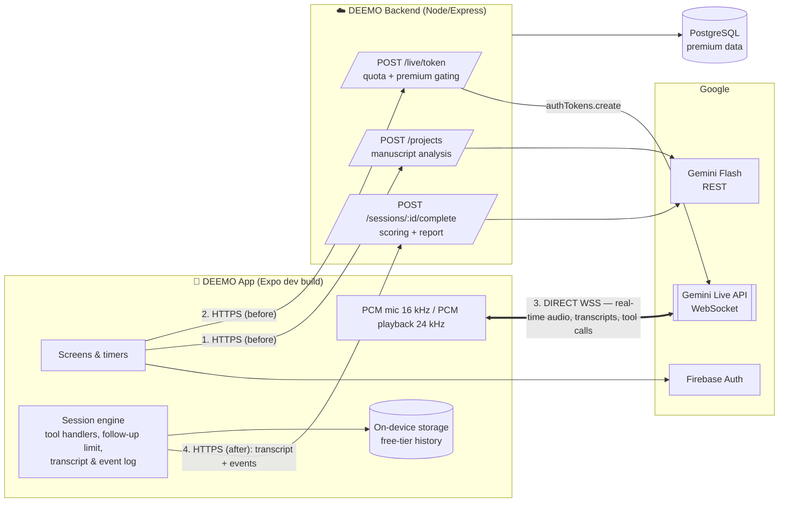
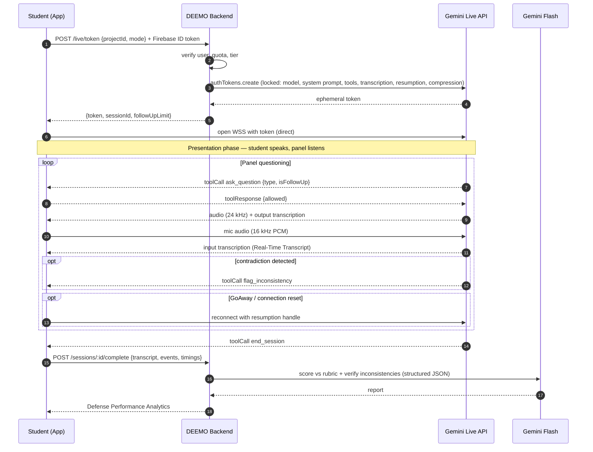

# DEEMO Plan — Addendum

**A. Suggested answers to the 10 open questions**
**B. Low-latency voice architecture (client → Gemini Live API directly)**

> Companion to `DEEMO_Mobile_App_Plan.md`. This addendum **replaces §10–§14 of that plan** (AI pipeline, architecture, tech stack, API) for anything involving the live session.
>
> ✅ = verified against current Google docs (Oct 2026) · 💡 = recommendation for your group to adopt and defend

---

## Part B first: Did the previous plan use low latency?

**No.** The original plan routed audio through your backend:

```
Phone ──audio──▶ Your Node server ──audio──▶ Gemini Live ──audio──▶ Your server ──audio──▶ Phone
```

That adds two extra network legs per turn, plus server buffering, and your server has to keep one long-lived WebSocket open per active user (expensive on free hosting tiers, and a single point of failure during a 15-minute defense).

**Your idea is correct, and it's the pattern Google officially supports.** ✅ Google's ephemeral-token guide describes it directly: since the client sends data directly to Gemini, this improves latency and avoids your backend needing to proxy the real-time data.

### New rule
| Path | What goes through it |
|---|---|
| **Phone ⇄ Gemini Live API (direct WSS)** | Everything real-time: mic audio, panel voice, live transcripts, tool calls (question type, follow-up count, inconsistency flags) |
| **Phone ⇄ Your backend (normal HTTPS)** | Only *non-real-time* work: login, minting a token **before** the session, manuscript analysis **before**, final scoring **after** |

Your server is never in the middle of a conversation turn.

---

## B1. How ephemeral tokens make this safe ✅

You can't ship your real Gemini API key inside the APK (it can be extracted). Instead:

1. App logs in (Firebase Auth) and asks your backend: *"I want to start a Pre-Oral session for project X."*
2. Backend checks the user's quota/tier, then asks Gemini for an **ephemeral token**.
3. Backend returns the token; the app connects to Live API **directly** with it, as if it were an API key.

Verified details:
- Defaults: **1 minute** to *start* a session with the token (`newSessionExpireTime`) and **30 minutes** to keep sending messages (`expireTime`).
- `uses: 1` = one session per token — but the **same token can be reused to reconnect** via session resumption within `expireTime` (needed because connections reset ~every 10 min).
- **Tokens can be locked to a config** (`liveConnectConstraints`): model, response modality, session resumption, etc. Google notes this also lets you **keep your system instructions on the server side**.
- Tokens only work with the **Live API** and the **v1beta** API version.
- Without the SDK, pass the token as an `access_token` query param or an `Authorization: Token <token>` header.
- ⚠ Ephemeral tokens are still labeled **Preview**.

### 💡 Why locking matters for DEEMO
Lock the **system instruction** (manuscript analysis + mode rules + rubric) and the **tool declarations** into the token on the server. Then:
- The manuscript context never has to be sent from the phone at connect time.
- A tampered app can't swap the model, remove the follow-up limit, or use your quota as a free general chatbot.

### Backend: token endpoint (Node.js) 💡

```ts
// POST /live/token   (requires Firebase ID token in Authorization header)
import { GoogleGenAI, Modality } from "@google/genai";
const ai = new GoogleGenAI({ apiKey: process.env.GEMINI_API_KEY }); // PAID-tier project key

app.post("/live/token", requireFirebaseAuth, async (req, res) => {
  const { projectId, mode } = req.body;                 // "TITLE" | "PRE_ORAL" | "FINAL"
  const user = req.user;

  await assertQuota(user, mode);                        // free tier limits, premium gating (Final mode)
  const analysis = await loadAnalysis(user, projectId); // structured JSON from manuscript analysis
  const rubric   = await loadRubric(user, projectId);

  const now = Date.now();
  const token = await ai.authTokens.create({
    config: {
      uses: 1,
      newSessionExpireTime: new Date(now + 60_000).toISOString(),       // must connect within 1 min
      expireTime: new Date(now + SESSION_CAP_MIN[mode] * 60_000).toISOString(), // cover session + pauses
      liveConnectConstraints: {
        model: LIVE_MODEL,                               // see B3
        config: {
          responseModalities: [Modality.AUDIO],
          systemInstruction: buildPanelPrompt({ analysis, rubric, mode, domain: analysis.domain }),
          tools: [{ functionDeclarations: PANEL_TOOLS }],
          inputAudioTranscription: {},                   // student's words → Real-Time Transcript
          outputAudioTranscription: {},                  // panel's words → captions
          sessionResumption: {},                         // survive ~10-min connection resets
          contextWindowCompression: { slidingWindow: {} } // go past the 15-min audio cap
        },
      },
    },
  });

  const sessionId = await createSessionRecord(user, projectId, mode);
  res.json({ token: token.name, sessionId, followUpLimit: 2 });
});
```

> Check the API reference for the maximum allowed `expireTime` before setting `SESSION_CAP_MIN.FINAL` (e.g. 25–30 min). If a session outlives the token, mint a fresh one and reconnect with the resumption handle.

---

## B2. Session limits and how DEEMO handles them ✅

| Limit | Value | DEEMO handling |
|---|---|---|
| Audio-only session **without** compression | **15 min** | Final Defense can run 15–20 min → **enable `contextWindowCompression`**, which extends sessions indefinitely |
| WebSocket **connection** lifetime | **~10 min** | Enable **`sessionResumption`**; store the latest `newHandle`; reconnect transparently |
| Warning before disconnect | **`GoAway`** message with `timeLeft` | On `GoAway`: finish current audio chunk, reconnect with the latest handle |
| Resumption handle validity | **2 hours** after termination | Lets a student recover from a dropped signal or a long pause |

### 💡 Compression caveat
The sliding window drops the oldest conversation turns when it triggers. That's fine for the conversation itself, because:
- The **system instruction** (manuscript facts) is what matters most, and it is not part of the sliding conversation history.
- Your **app keeps the full transcript** locally, so scoring is never affected by compression.

### Pause / Resume 💡
- **Pause:** stop streaming mic audio, mute playback, freeze timers on the client. If the pause runs long and the connection closes, that's fine — keep the handle.
- **Resume:** if the socket is closed, reconnect with the resumption handle (same token if still within `expireTime`, otherwise fetch a new token from `/live/token?resume=sessionId`).

---

## B3. Model choice ✅ / 💡

- Google's current Live docs use the **`gemini-3.8-live`** model in their examples (older examples reference `gemini-3.1-flash-live-preview` and `gemini-2.5-flash-native-audio-*`). Model names change often — **confirm on the Models page before coding** and put the name in one config constant.
- 💡 Keep **two model roles**:
  - **Live model** → only the real-time panel conversation.
  - **Regular Flash model (REST, server-side)** → manuscript analysis *before* the session and authoritative scoring *after*. These are heavy, non-real-time jobs that don't belong in the live socket.
- Your Chapter 2 names *Gemini 2.5 Flash*; update Chapter 2/3 to the model versions you actually ship with, and state that model versions may change during development.

---

## B4. Tool calling inside the Live session (no server hop) 💡

Live API supports function calling: the model emits a `toolCall`, **your app** runs it locally, and replies with a `toolResponse`. This is how the panel drives your UI features in real time.

```ts
export const PANEL_TOOLS = [
  {
    name: "ask_question",
    description: "Call BEFORE speaking each new main or follow-up question.",
    parameters: {
      type: "OBJECT",
      properties: {
        topicId:      { type: "STRING" },
        questionText: { type: "STRING" },
        questionType: { type: "STRING", enum: ["TECHNICAL","METHODOLOGICAL","CONCEPTUAL","CLARIFICATORY"] },
        isFollowUp:   { type: "BOOLEAN" },
        panelist:     { type: "STRING", description: "Persona label, e.g. Chair, Technical, Methodology" }
      },
      required: ["topicId","questionText","questionType","isFollowUp"]
    }
  },
  {
    name: "flag_inconsistency",
    description: "Call when the student's answer contradicts the manuscript facts in your instructions.",
    parameters: {
      type: "OBJECT",
      properties: {
        spokenClaim:        { type: "STRING" },
        manuscriptEvidence: { type: "STRING" },
        severity:           { type: "STRING", enum: ["LOW","MEDIUM","HIGH"] }
      },
      required: ["spokenClaim","manuscriptEvidence","severity"]
    }
  },
  {
    name: "end_session",
    description: "Call when all planned topics are covered or time is up.",
    parameters: { type: "OBJECT", properties: { reason: { type: "STRING" } } }
  }
];
```

### The client enforces the rules (so the AI can't "forget" them) 💡

```ts
function onToolCall(call) {
  switch (call.name) {
    case "ask_question": {
      const { topicId, isFollowUp } = call.args;
      if (isFollowUp && followUps[topicId] >= FOLLOW_UP_LIMIT) {
        // Bounded Adaptive Follow-Up enforced in code, not just in the prompt
        return respond(call, { allowed: false, instruction: "Follow-up limit reached. Move to the next topic." });
      }
      if (isFollowUp) followUps[topicId] = (followUps[topicId] ?? 0) + 1;
      ui.showQuestion(call.args);          // Question-Type Indicator chip + panelist avatar
      timers.markQuestionAsked();          // starts Response Duration Tracking
      return respond(call, { allowed: true });
    }
    case "flag_inconsistency":
      events.push({ type: "inconsistency", ...call.args, at: timers.sessionMs() });
      ui.markTranscriptLine(call.args);    // subtle in-session marker (see Q3)
      return respond(call, { ok: true });
    case "end_session":
      return finishSession();
  }
}
```

**Response Duration Tracking** also lives on the client: `question audio ends → first input-transcription chunk` = latency; `first chunk → turn complete` = answer length. No round-trip to your server needed.

---

## B5. Revised architecture



### Full session sequence



---

## B6. React Native / Expo implementation notes 💡

| Concern | Recommendation |
|---|---|
| Expo Go | **Won't work** — raw PCM streaming needs native modules. Use an **Expo development build** (`expo-dev-client`) from week 1. |
| Mic streaming (16 kHz, 16-bit PCM mono) | `react-native-audio-api` (Software Mansion) or `@siteed/expo-audio-studio`. Both offer streaming PCM chunks. Prototype both in week 1 and keep whichever runs cleanest on your lowest-end test phone. |
| Playback (24 kHz PCM chunks) | A queued buffer player (e.g. `react-native-audio-api` buffer sources). Avoid writing WAV files per chunk; that adds noticeable delay. |
| WebSocket | React Native's built-in `WebSocket` to the Live endpoint with `access_token=<ephemeral token>`. If `@google/genai`'s `live.connect` runs cleanly in your RN build, use it; otherwise use the raw WebSocket protocol from Google's "Get started using raw WebSockets" guide. |
| Echo (panel voice re-captured by mic) | Strongly recommend **earphones** (enforce on the mic-check screen). Use a voice-communication audio mode so Android applies echo cancellation. Mute the mic while the panel is speaking if barge-in causes problems. |
| Permissions | `RECORD_AUDIO`; keep the screen awake during sessions; handle app backgrounding (auto-pause). |
| Firebase alternative | Firebase AI Logic also offers client-side Live API access with **App Check**, removing the token server entirely. 💡 Prefer your own token endpoint: it's where you enforce freemium quotas and lock the manuscript prompt, which are both things your panel will ask about. |

### Latency expectations (honest version)
Direct connection removes your server hop in both directions, so the remaining delay is mostly **model response time + mobile network**. Don't promise a specific number in the paper. Instead, **measure it**: log `student stops speaking → first panel audio byte` for every turn and report the mean/median in Chapter 4 under ISO 25010 *Performance Efficiency → Time behaviour*. That gives you real data instead of a claim.

---

## B7. Updated tech stack (live-session parts)

| Layer | Old plan | New |
|---|---|---|
| Live audio path | App → Node WS proxy → Gemini | **App → Gemini Live API directly (WSS)** |
| Live auth | Server-held key | **Ephemeral token** minted by backend, locked to model + prompt + tools |
| STT / TTS | Separate services | **Built into Live model** (native audio + input/output transcription) |
| Question type, follow-ups, inconsistency flags | Server orchestrator | **Live function calling → handled on device** |
| Timers | Server | **Device** |
| Manuscript analysis | Server + Flash | Server + Flash (unchanged) |
| Scoring/report | Server + Flash | Server + Flash, from transcript uploaded **after** session |
| Backend role | Real-time orchestrator | **Auth, quotas, token minting, analysis, scoring, storage** |

---

# Part A — Suggested answers to the open questions

Each answer gives: **Decision → Why → What to write in the paper.**

---

### Q1. Freemium specifics

**Decision 💡**

| Capability | Free | Premium |
|---|---|---|
| Projects | 1 | Unlimited |
| Title Defense Mode | ✅ | ✅ |
| Pre-Oral Defense Mode | ✅ | ✅ |
| **Final Defense Mode** | 🔒 | ✅ |
| Sessions per day | 2 | 10 (fair-use cap) |
| Max session length | 10 min | 25 min |
| Custom rubric upload | ✅ | ✅ |
| Multi-panelist personas | 🔒 | ✅ |
| Basic report (readiness score + transcript + inconsistencies) | ✅ | ✅ |
| **Detailed analytics** (per-criterion breakdown, response-time chart, filler/pace stats, improved sample answers, progress trend) | 🔒 | ✅ |
| History | On device | Cloud-synced |
| PDF export | 🔒 | ✅ |

- *"Advanced defense simulations"* = Final Defense Mode + multi-panelist personas + longer sessions.
- *"Detailed performance analytics"* = everything beyond the basic score, transcript and inconsistency list.

**Payments:** use a **mock subscription** (an admin toggle or promo codes) for the capstone. If DEEMO is ever published on Google Play, digital subscriptions must go through **Google Play Billing**. State this as a delimitation.

**Why:** the free tier still fully supports the study's core claims (SO3, SO5). The gating is defensible because the Final Defense is the highest-stakes, longest, and most expensive session to run.

**Paper:** Scope — *"The freemium model is simulated; no real payment transactions are processed. All 40 respondents are granted Premium access during evaluation so that all features in scope are assessed."*

---

### Q2. Adviser (secondary user) features

**Decision 💡:** No adviser account or dashboard. Instead:
1. **PDF export / share report** (premium), so students can send results to their adviser.
2. Optionally, a **read-only share link** to a single report, which expires after 7 days.

**Why:** a full adviser role means a second user type, permissions, and an extra web or mobile UI, which roughly doubles the testing scope. It also contradicts Chapter 1's own Significance statement, which says DEEMO is designed primarily for individual student use.

**Paper:** revise Significance to say advisers *"may review students' exported performance reports to identify areas needing improvement."* Add to Delimitations: *"A dedicated adviser monitoring dashboard is not included in this study."*

---

### Q3. "Live" consistency checking — during the session or only in the report?

**Decision 💡: both, layered.**

| Layer | When | How it appears |
|---|---|---|
| **1. Panel challenge** (realism) | During | When `flag_inconsistency` is HIGH severity, the AI panelist **asks about it out loud** as a follow-up — exactly what a real panel does ("Earlier you said 30 respondents, but your paper says 40. Which is correct?") |
| **2. Subtle marker** | During | A small amber dot on that transcript line. No pop-ups, no alarms. |
| **3. Verified list** | After | The server re-checks every flag against the manuscript using Flash and drops false alarms. The report shows each spoken claim next to the manuscript evidence. |

Add a setting, **"Coach mode vs Panel mode"**: Coach mode shows markers; Panel mode hides them during the session (most realistic).

**Why:** pop-up warnings break immersion and add to anxiety, which is one of the problems DEEMO is meant to address. Verbal challenges make the feature feel like a real panel, and the post-session verification protects accuracy.

**Paper:** define the *Live Verbal Consistency Checker* as *"real-time detection during the session, surfaced through panel follow-up questions and transcript markers, with verified results presented in the Defense Performance Analytics."*

---

### Q4. Readiness score formula

**Decision 💡**

```
Rubric Score (RS)       = Σ ( weight_i × level_i / 5 ) × 100        // level_i ∈ 1..5, Σ weights = 1
Consistency Penalty (CP)= min( 15 , 5×HIGH + 2×MEDIUM + 0.5×LOW )   // verified inconsistencies only
Coverage Factor (CF)    = answered_main_questions / planned_main_questions   (floor 0.6)

Readiness Score = clamp( RS × CF − CP , 0 , 100 )
```

Hesitation and fillers are **not** subtracted separately: they already count inside the *Confidence & Delivery* criterion (Q5), so subtracting them again would double-count.

**Worked example (Pre-Oral session):**

| Criterion | Weight | Level (1–5) | Contribution |
|---|---|---|---|
| Content Mastery | 0.25 | 4 | 20.0 |
| Reasoning & Justification | 0.20 | 3 | 12.0 |
| Clarity & Organization | 0.20 | 4 | 16.0 |
| Consistency with Manuscript | 0.20 | 3 | 12.0 |
| Confidence & Delivery | 0.15 | 3 | 9.0 |
| **RS** | | | **69.0** |

- Planned 8 main questions, answered 8 → CF = 1.0
- Verified inconsistencies: 1 HIGH, 1 MEDIUM → CP = 7
- **Readiness = 69 × 1.0 − 7 = 62**

**Readiness bands:**

| Score | Band | Message |
|---|---|---|
| 85–100 | Defense-ready | Polish delivery |
| 70–84 | Nearly ready | Fix weak criteria |
| 50–69 | Developing | Practice flagged topics |
| < 50 | Needs preparation | Review manuscript before retrying |

**Why:** the formula is transparent, reproducible, and every point can be explained, which matters when the panel asks how the score is computed. Rubric levels come from the LLM with a required justification per criterion; the arithmetic is done **in code**, not by the AI.

**Paper:** put the formula and bands in Chapter 3. State that scores are *practice indicators with no academic weight* (already a Chapter 1 delimitation).

---

### Q5. Default rubric — and measuring "confidence" without emotion recognition

**Decision 💡:** five criteria. This mirrors common Philippine IT capstone oral-defense forms, which typically cover mastery of the study, ability to answer questions, delivery, and organization. Consistency is DEEMO's own addition.

| Criterion | Weight | 5 — Excellent | 3 — Satisfactory | 1 — Poor |
|---|---|---|---|---|
| **Content Mastery** | 25% | Accurate, complete, uses correct technical terms | Mostly correct, some gaps | Incorrect or unable to explain |
| **Reasoning & Justification** | 20% | Clearly justifies design/method choices with reasons and alternatives | Gives reasons but shallow | States choices without justification |
| **Clarity & Organization** | 20% | Direct answer first, logical structure, concise | Understandable but wandering | Disorganized, off-topic |
| **Consistency with Manuscript** | 20% | No contradictions with the paper | Minor discrepancies | Major contradictions |
| **Confidence & Delivery** | 15% | Prompt start, steady pace, few fillers | Some hesitation and fillers | Long pauses, frequent fillers, incomplete answers |

**Measuring confidence with observable proxies (no emotion recognition)** — computed in code from transcripts and timestamps:

| Proxy | Source | Indicative "5" target 💡 |
|---|---|---|
| Response latency (question end → speech start) | Timestamps | ≤ 3 s |
| Filler-word rate ("uhm", "ah", "parang", "like") | Input transcription | ≤ 3 per minute |
| Speaking rate | Words ÷ speaking time | 110–160 words/min |
| Answer completeness | Did the answer address the question? (LLM judgment) | Complete |
| Abandoned or restarted answers | Transcript patterns | Rare |

Map the proxies to levels 1–5 with fixed thresholds and **calibrate the thresholds during pilot testing** with 3–5 students.

**Paper:** operationally define *Confidence* as *"observable verbal delivery indicators (response latency, filler-word frequency, speaking rate, and answer completeness), not emotional or biometric states."* This stays consistent with your exclusion of biometric emotion recognition.

---

### Q6. ISO/IEC 25010 — which edition?

**Decision 💡: use ISO/IEC 25010:2023, and fix Chapter 2.**

⚠ Chapter 2 says the 2023 standard has **eight** characteristics. It has **nine**. The 2023 revision:
- renamed **Usability → Interaction Capability**
- renamed **Portability → Flexibility**
- added **Safety**

**Characteristics to evaluate:**

| Characteristic | Use in DEEMO | Example items |
|---|---|---|
| Functional Suitability | ✅ | Questions are relevant to my manuscript; scores reflect my answers |
| Performance Efficiency | ✅ | Panel responds without long delays (plus measured latency) |
| Compatibility | ✅ | Works with my phone and earphones |
| Interaction Capability | ✅ | Easy to learn; clear screens; transcripts readable |
| Reliability | ✅ | Recovers from drops or pauses; no crashes |
| Security | ✅ | My manuscript and data feel protected |
| Maintainability | ✅ (IT expert respondents only) | |
| Flexibility | ✅ (IT expert respondents only) | |
| Safety | Justify as N/A, or interpret narrowly as "no harmful or misleading feedback" | |

Also update Chapter 1's *Definition of Terms*, which uses the older characteristic names. If your adviser's department requires the **2011** edition, use 2011 consistently across all chapters instead. The key is to name **one edition** and not mix them.

---

### Q7. Multi-panelist simulation

**Decision 💡: in scope as a Premium feature, using one Live session with 2–3 personas.**

- The system prompt defines personas, for example **Chair** (scope and significance), **Technical Panelist** (architecture, database, testing), and **Methodology Panelist** (sampling, instruments, statistics).
- Each `ask_question` tool call includes `panelist`, and the UI highlights the matching avatar and name.
- **One voice** for all personas. A Live session uses a single voice configuration, and running parallel sessions to get different voices would multiply cost and latency. Personas are distinguished by name, avatar, and questioning style.

**Why:** it delivers Chapter 1's "multi-panelist questioning conditions" at near-zero extra cost.

**Paper:** *"Multi-panelist mode simulates up to three panelist personas with distinct questioning focus, presented through a single synthesized voice."*

---

### Q8. Platform

**Decision 💡: Android only for this study.** Expo keeps iOS possible later.

**Why:** your 40 respondents can install an APK directly; iOS distribution needs a paid Apple developer account plus TestFlight, and doubles device testing.

**Paper (Delimitations):** *"DEEMO is developed and evaluated on Android devices (Android 8.0 or later). Although built with a cross-platform framework, iOS deployment is outside the scope of this study."*

---

### Q9. Data retention and privacy

**Decision 💡**

| Data | Stored? | Where | How long |
|---|---|---|---|
| Uploaded manuscript file | **No** — processed in server memory, then discarded | — | Duration of analysis only |
| Structured manuscript analysis (summary + key facts) | Yes (needed to build each session's panel prompt) | Free: on device · Premium: database | Until the user deletes the project |
| Uploaded rubric | Structured criteria only | Same as above | Until deleted |
| **Raw voice audio** | **No** — streamed to Gemini, never recorded by DEEMO | — | — |
| Transcripts, events, scores, reports | Yes | Free: on device · Premium: database | Until deleted by the user; research copies anonymized and deleted after the study (e.g. 6 months after the final defense) |
| Account info | Yes | Firebase Auth / database | Until account deletion |

**Two critical Gemini terms issues ✅:**

1. **Use the paid tier (a billing-enabled Cloud project).** On the *unpaid* tier, Google uses submitted content to improve its products, and **human reviewers may read your inputs and outputs**. Google explicitly warns not to submit sensitive, confidential, or personal information to unpaid services. On *paid* services, Google does not use prompts or responses to improve its products and only logs them for a limited period for abuse detection. **Unpublished manuscripts plus students' voices must therefore go through the paid tier.** Costs during development are small, but set billing alerts.
2. **Age requirement.** The Gemini API terms require users to be **18 or older**, and API clients must not be directed toward people under 18. Fourth-year college students are generally adults, but **add "respondents must be at least 18 years old" to your respondent criteria and consent form**, and include an age confirmation in the app's consent screen.

**DPA (RA 10173) items to add:** consent screen; a privacy notice naming Google as an AI processor; in-app *Delete my data*; and a breach-response procedure that notifies the NPC and affected users within 72 hours.

**Paper:** add this table to Chapter 3 under *Data Privacy and Security*.

---

### Q10. Group manuscripts

**Decision 💡: one shared project per capstone group; individual sessions per member.**

- The group leader uploads the manuscript once, creating a **Project** with a 6-character **join code**.
- Members join with the code. All share the same analysis and rubric (uploaded once, saving analysis cost).
- Each member's **sessions and scores are private by default**. An optional *"Share with group"* toggle shows a member's latest readiness score on a small **Group Readiness** card, so the team can see who needs more practice.
- Optional session setting: **"Focus area"**. Members pick a chapter or role (e.g. "I handle database and testing"), and the panel weights questions toward it, mirroring how real panels direct questions to specific members.

**Why:** capstones are team defenses, and every member gets questioned. Sharing the analysis avoids five uploads of the same paper.

**Paper:** add *Group Project Sharing* to the feature list in Chapter 3. In Chapter 1, the respondents are still counted as 40 individual students.

---

## Summary of changes to make in your manuscript

| Where | Change |
|---|---|
| Ch1 Scope | Android-only; freemium simulated; adviser dashboard excluded; respondents 18+ |
| Ch1 Definition of Terms | Update ISO 25010 characteristic names (2023); define *Confidence* by observable proxies; add *Ephemeral Token*, *Group Project* |
| Ch1 Significance | Advisers review **exported reports** |
| Ch2 Technologies | Fix "eight characteristics" → nine; update Gemini model versions; describe direct client-to-Live connection with ephemeral tokens |
| Ch3 | Readiness Score formula + bands; default rubric table; data retention table; revised architecture and sequence diagrams |

---

### Sources
- [Ephemeral tokens — Gemini API](https://ai.google.dev/gemini-api/docs/live-api/ephemeral-tokens)
- [Session management with Live API](https://ai.google.dev/gemini-api/docs/live-api/session-management)
- [Live API tool use](https://ai.google.dev/gemini-api/docs/live-api/tools)
- [Gemini API Additional Terms of Service](https://ai.google.dev/gemini-api/terms)
